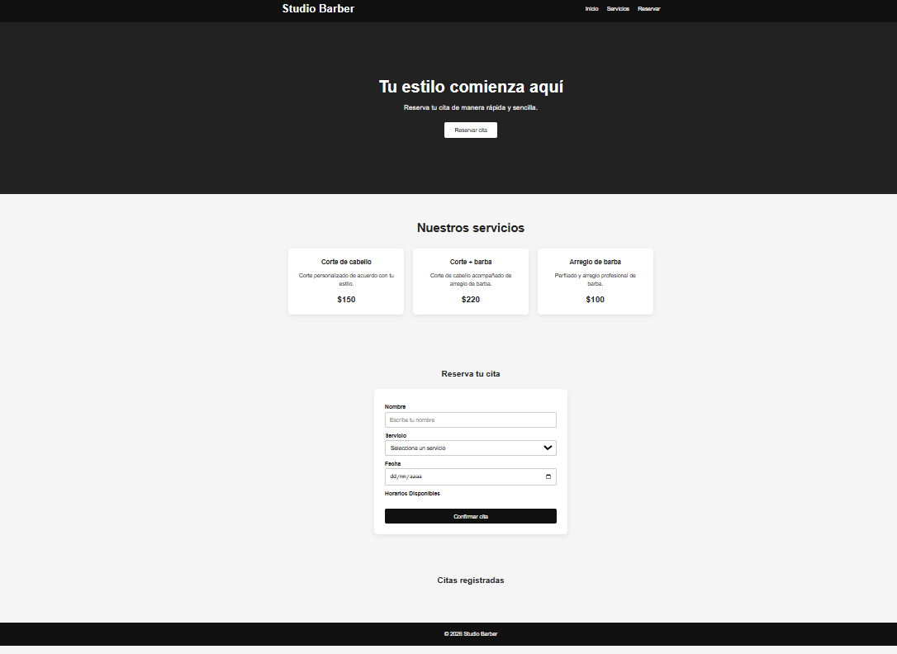
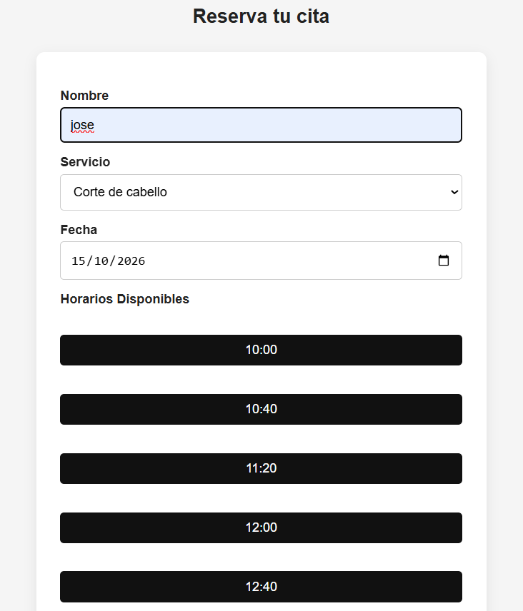
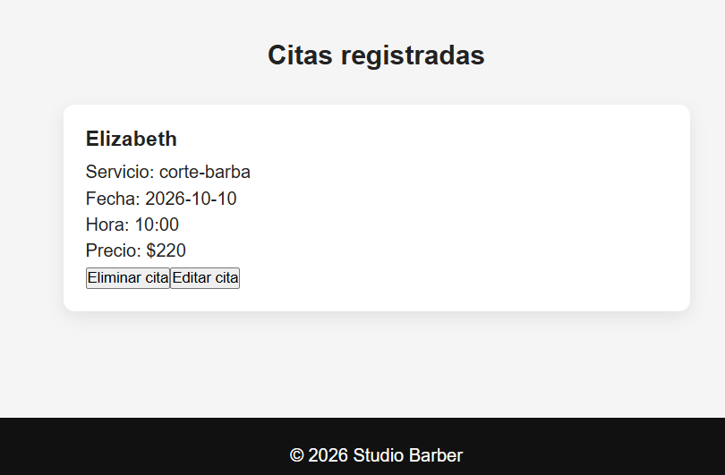

Studio Barber es una aplicación web que permite gestionar citas de una barbería mediante una interfaz sencilla e intuitiva.

El sistema permite seleccionar servicios, horarios disponibles y administrar las citas almacenando la información localmente en el navegador.

Demo: https://aaronjh08.github.io/sistema-citas-estetica/

## Funcionalidades

- Registro de citas
- Selección de servicio
- Selección de fecha
- Generación dinámica de horarios
- Validación de disponibilidad
- Detección de empalmes de horarios
- Visualización de citas registradas
- Edición de citas
- Eliminación de citas
- Persistencia de datos con LocalStorage
- Restricción de edición cuando la cita está próxima

## Servicios disponibles

| Servicio | Precio | Duración |
|---|---|---|
| Corte | $150 | 40 minutos |
| Corte + barba | $220 | 60 minutos |
| Barba | $100 | 30 minutos |

## Tecnologías utilizadas

- HTML5
- CSS3
- JavaScript
- DOM
- LocalStorage
- Git
- GitHub Pages

## Vista previa

## Aprendizajes

Proyecto desarrollado para reforzar conocimientos en:

- Manipulación del DOM
- Manejo de eventos
- Trabajo con fechas y horarios
- Persistencia de información en navegador
- Control de lógica de negocio en frontend
